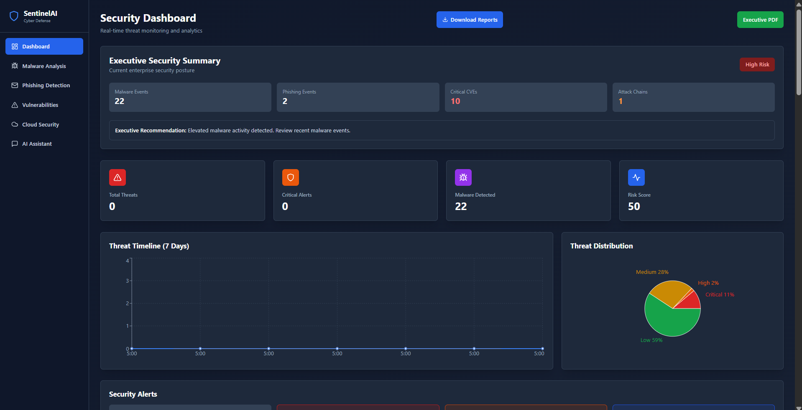
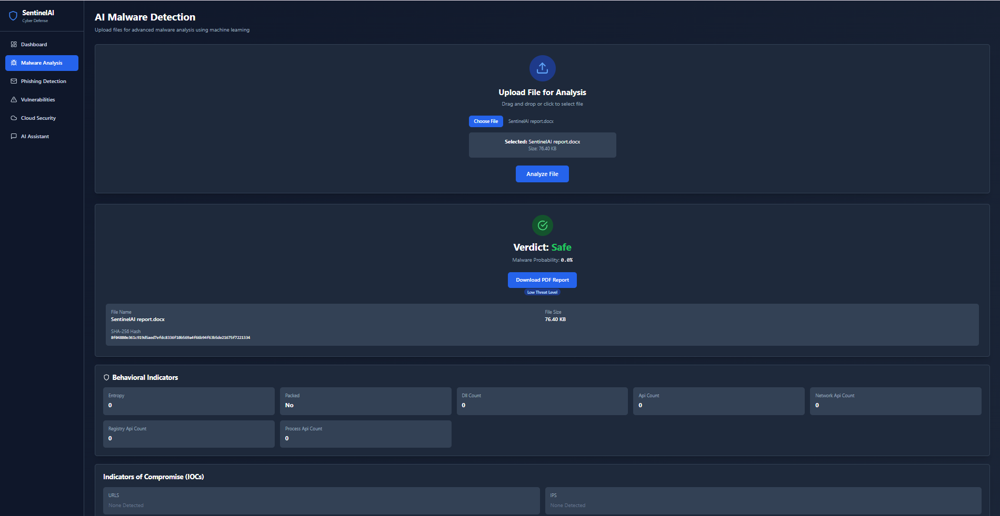
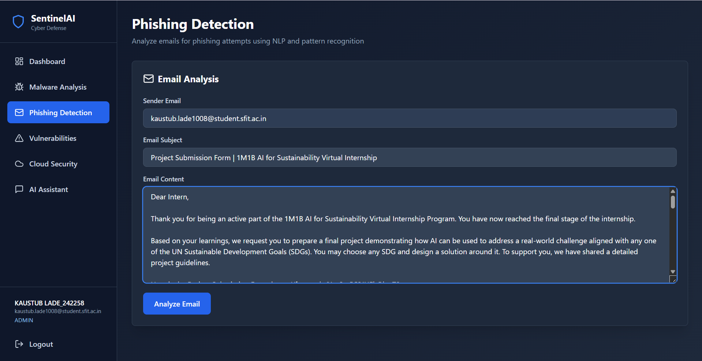
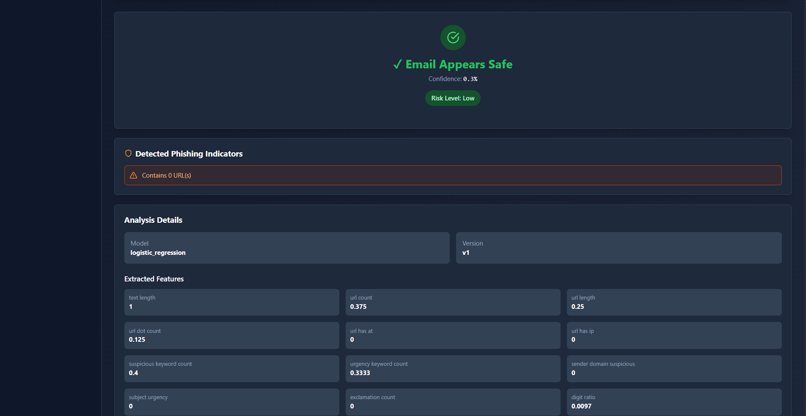
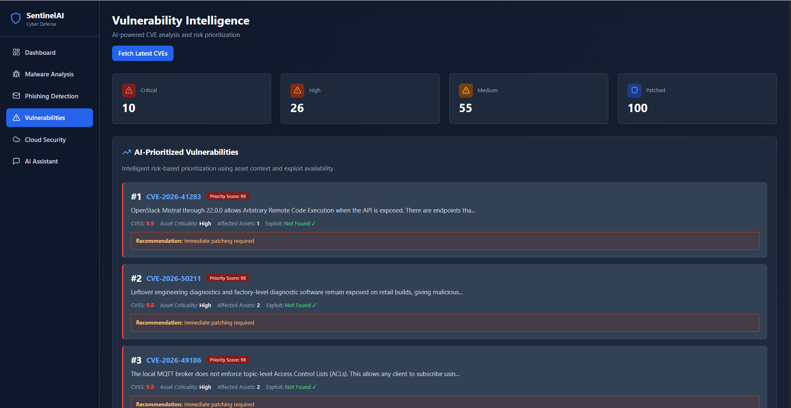
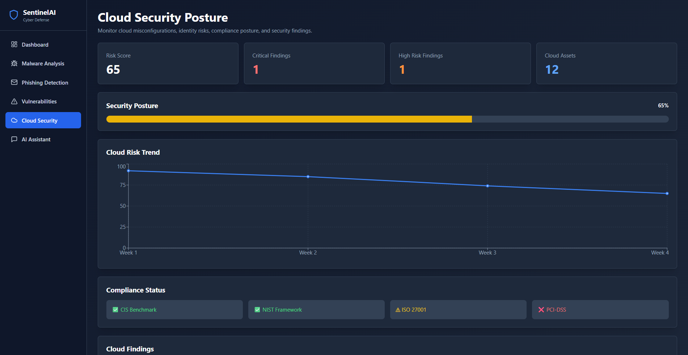
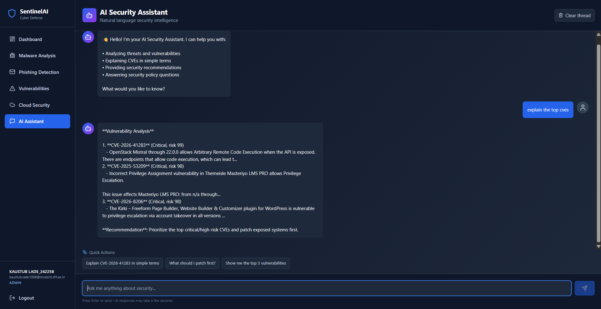

# SentinelAI: Autonomous Cyber Defense Platform

**SentinelAI** is a professional-grade, AI-powered cybersecurity platform designed for autonomous threat detection, phishing analysis, and vulnerability prioritization. Built to streamline security operations, it integrates machine learning models with industry-standard frameworks like MITRE ATT&CK to provide a unified defense interface.

---

## 1. Project Overview
SentinelAI functions as a comprehensive security ecosystem, combining a **React-based frontend** with a **FastAPI backend** to monitor and mitigate digital threats. It leverages AI to assist security analysts in identifying malware, analyzing phishing attempts, and prioritizing vulnerabilities based on real-time intelligence.

## 2. Problem Statement
Modern organizations face an overwhelming volume of security alerts and complex threat landscapes. Manual analysis of malware, phishing, and CVEs (Common Vulnerabilities and Exposures) is time-consuming and prone to human error, leading to delayed response times and increased risk of exploitation.

## 3. Objectives
*   To automate the detection and analysis of malware using static features and YARA hooks.
*   To provide an AI-driven security assistant for real-time threat interrogation.
*   To prioritize vulnerabilities using intelligent CVE assessment.
*   To map detected threats to the MITRE ATT&CK framework for standardized reporting.
*   To deliver executive-level reporting through automated PDF generation.

## 4. Key Features
*   **AI-Powered Detection:** Heuristic and machine learning for phishing and malware analysis.
*   **Vulnerability Intelligence:** Automated CVE prioritization to focus on critical risks.
*   **Security Assistant:** An integrated AI UI for security-related queries and assistance.
*   **Enterprise Security:** Role-Based Access Control (RBAC), audit logging, and JWT authentication with refresh tokens.
*   **Observability:** Integrated security and observability using Docker Compose.

## 5. Highlights

- AI-powered malware analysis
- NLP-based phishing detection
- CVE prioritization and risk scoring
- MITRE ATT&CK mapping
- Cloud security posture monitoring
- Executive PDF reporting
- AI Security Assistant powered by Groq

## 6. System Architecture Overview
The platform follows a modern microservices-inspired architecture:
*   **Frontend:** A responsive UI built with React, Vite, and Tailwind CSS.
*   **Backend:** High-performance API powered by FastAPI (Python).
*   **Data Tier:** MongoDB Atlas for flexible, cloud-native data storage.
*   **Task Management:** Celery and Redis for handling asynchronous security tasks and queues.
*   **AI Engine:** Integration with Groq for production-grade LLM capabilities.

## 7. Technology Stack
*   **Languages:** Python (40.7%), JavaScript (23.1%), Jupyter Notebooks (34.7%).
*   **Frameworks:** FastAPI, React.
*   **Database:** MongoDB Atlas.
*   **DevOps & Infrastructure:** Docker, Docker Compose, Vercel (Frontend), Render (Backend).
*   **AI/ML:** Groq LLM, LightGBM (EMBER-2018), YARA, Pydantic.

## 8. Module Descriptions
*   **Malware Detection:** Static PE feature extraction with a LightGBM model trained on the EMBER-2018 benchmark, plus YARA hooks and heuristic fallbacks for non-PE files.
*   **Phishing Detection:** Employs a combination of heuristic rules and machine learning to identify malicious URLs and communications.
*   **Vulnerability Intelligence:** Aggregates CVE data and provides prioritization intelligence to help teams patch critical flaws first.
*   **MITRE ATT&CK Mapping:** Includes map identified threats to specific tactics and techniques within the MITRE ATT&CK matrix.
*   **IOC Intelligence:** (Handled through the threat detection modules for identifying Indicators of Compromise).
*   **Threat Correlation Engine:** Integrated within the backend to link various security events (implied by platform scope).
*   **Security Assistant:** A specialized UI component that allows users to interact with an AI trained for security contexts.
*   **Cloud Security Monitoring:** Supported by dedicated security and observability for cloud-native environments.
*   **Alert Management:** Features rate limiting and audit logging to manage and track security alerts efficiently.
*   **Executive Reporting:** Includes functionality for automated "Executive PDF" creation for high-level stakeholders.

## 9. Folder Structure
```text
SentinelAI/
├── .github/workflows/    # CI/CD pipelines
├── backend/              # FastAPI source code, models, and API logic
├── frontend/             # React source code and UI components
├── ember-master/         # Additional project modules
├── docker-compose.yml    # Orchestration for local development
├── DEPLOYMENT.md         # Production configuration guides
└── README.md             # Project documentation
```

## 10. Installation Instructions
### Prerequisites
*   Python 3.x
*   Node.js & npm
*   Docker & Docker Compose

### Setup
1.  **Backend:**
    *   Navigate to `/backend`.
    *   Configure the `.env` file with MongoDB and Groq API credentials.
    *   Install dependencies (refer to `runtime.txt` for specific versions).
2.  **Frontend:**
    *   Navigate to `/frontend`.
    *   Set the `.env` file with the `ALLOWED_ORIGINS` and Backend API URL.
3.  **Run with Docker:**
    *   Use `docker-compose up` to start the backend, frontend, and Redis services simultaneously.
4.  **Local Scripts:**
    *   Windows users can use `start-all.bat`, `start-backend.bat`, or `start-frontend.bat` for quick startup.

## 11. API Overview
SentinelAI provides a fully documented REST API:
*   **API Documentation:** Accessible via `/docs` (Swagger UI) when the backend is running.
*   **Base URL:** `https://sentinelai-3glx.onrender.com/docs`.
*   **Key Endpoints:** Includes authentication, threat analysis, and vulnerability reporting.

## 12. Dashboard Features
*   **Real-time Threat Monitoring:** Visualizing active malware and phishing threats.
*   **Vulnerability Priority List:** A ranked view of CVEs affecting the environment.
*   **Interactive AI Chat:** The Security Assistant interface for direct query handling.

## 13. Security Features
*   **Authentication:** JWT with refresh token rotation.
*   **Authorization:** Role-Based Access Control (RBAC) and role checks.
*   **Infrastructure Security:** Atlas TLS hardening and secure production LLM configurations.
*   **Accountability:** Full audit logging for user and system actions.

## 14. Machine Learning: EMBER-2018 Malware Detection

Malware scoring is driven by a LightGBM classifier trained on the
[EMBER-2018 dataset](https://github.com/elastic/ember), the Elastic Malware
Benchmark for Empowering Researchers. This replaces the previous hand-written
heuristic demo data with real, benchmark-derived telemetry.

### Dataset

| Property | Value |
| --- | --- |
| Archive | `ember_dataset_2018_2.tar.bz2` (1,696,539,273 bytes) |
| SHA-256 | `b6052eb8d350a49a8d5a5396fbe7d16cf42848b86ff969b77464434cf2997812` |
| Feature version | 2 (2381 features per PE file) |
| Training pool | 120,000 sampled samples (46,081 malicious) from `train_features_0/1.jsonl` |
| Evaluation set | 30,000 sampled samples (14,993 malicious) from `test_features.jsonl` |

The EMBER-2018 archive ships raw JSONL features rather than pre-vectorized
matrices, so `backend/scripts/vectorize_ember_jsonl.py` streams the shards and
re-vectorizes them with a vendored copy of the official feature extractor
(`backend/app/services/ember_features.py`, LIEF-based, AGPL-free import path).

### Model

* **Algorithm:** LightGBM (`num_leaves=64`, 395 trees after early stopping)
* **Artifact:** `backend/app/ml/ember_model.txt` (2.93 MB, plain text, loaded by
  `backend/app/services/ember_model.py`)
* **Scoring path:** static PE features → EMBER vector → `predict_proba`;
  non-PE uploads fall back to the existing heuristic analyzer.

Measured on the official EMBER-2018 test split (unseen during training):

| Metric | Value |
| --- | --- |
| ROC-AUC | 0.9822 |
| Accuracy | 0.9359 |
| Precision | 0.9628 |
| Recall | 0.9068 |
| F1 | 0.9339 |

Full numbers are stored in `backend/app/ml/ember_metrics.json`. Every analysis
response reports `engine: "ember-lightgbm-v2"`, which the UI renders as
*Detection engine: EMBER-2018 LightGBM*. A probability of 0.9 or higher is
reported as **Malicious / High**.

### Benchmark labelling

Dashboard records produced from EMBER are written with `source: "ember"` and
`dataset: "EMBER-2018"`, and the recent-threats table renders an indigo
`EMBER-2018` badge next to them, so benchmark samples are never presented as
live customer telemetry. The seeded demo rows were removed.

### Reproducing the model

```bash
# 1. Vectorize raw EMBER JSONL features into memmapped pools
python backend/scripts/vectorize_ember_jsonl.py \
  --shards /data/ember2018/train_features_1.jsonl /data/ember2018/train_features_0.jsonl \
  --limit 120000 --out-dir /data/pool_train

python backend/scripts/vectorize_ember_jsonl.py \
  --shards /data/ember2018/test_features.jsonl \
  --limit 30000 --out-dir /data/pool_test

# 2. Train + evaluate, writing the model, metrics and dashboard holdout
python backend/scripts/train_ember_model.py \
  --pool-dir /data/pool_train --test-pool-dir /data/pool_test \
  --trees 400 --leaves 64 --holdout 400

# 3. Load EMBER-derived records into MongoDB
python backend/scripts/backfill_ember_dashboard.py --db sentinalai
```

## 15. Screenshots Section
### Security Dashboard


### AI Malware Detection


### Phishing Detection



### Vulnerability Intelligence


### Cloud Security Posture


### AI Security Assistant


## Live Demo

Frontend: https://sentinel-ai-flame.vercel.app/login

API Documentation:
https://sentinelai-3glx.onrender.com/docs

## Demo Credentials

Use the following demo account to explore the platform:

```text
Email: demo@sentinelai.com
Password: Demo@123
```

> Note: This is a demonstration account with limited privileges and sample security data.

## 16. Future Scope
*   Expansion of MITRE ATT&CK mapping to full automation.
*   Periodic retraining of the EMBER model on newer benchmark releases for broader malware-family coverage.
*   Extended cloud security integrations as noted in the project roadmap (`TODO.md`).

## 17. Authors
*   **Kaustub Lade** - *Lead Developer*

## 18. License
This project is part of a professional portfolio and engineering submission. Please refer to the repository for specific licensing details (e.g., MIT/Apache).